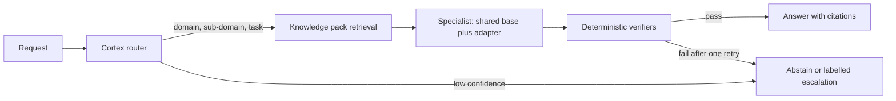
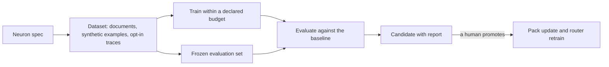

# DONWI Neuron

Tiny specialist models that run well on a CPU, a routing core that picks the right one,
and a lab that trains new ones on the same small machine.

DONWI Neuron (`neuron`) is the model layer of the DONWI Agent Suite.
[DONWI Brain](https://github.com/hi-donwi/Donwi-Brain) is the gateway in front of models;
DONWI Neuron builds, packages, routes, and serves the small models themselves.

> **Status: milestone N0 in progress.** The repository builds and gates itself, and
> `neuron version` is the only command that exists; the others shown below are planned.
> Every number in these documents is a budget to confirm by measurement in milestone N0,
> not a result, except in the spike write-ups under [docs/spikes](docs/spikes/README.md).

## Why

A language model with fewer than one billion parameters is fast on a CPU, but it knows
little and reasons weakly. Asked to be a general assistant, it disappoints. Given one
narrow job, the facts it needs, and a fixed output shape, it is often good enough, and it
answers without a GPU.

DONWI Neuron is built on that observation. It does not try to make one small model smart.
It splits the work into small parts and gives each part to the cheapest thing that can do
it:

- deciding what a request is about is a classification problem, not a generation problem;
- facts are looked up, not remembered;
- wording, format, and procedure for one sub-domain are learned by a small adapter;
- the shape of the output is enforced by the decoder, and the result is checked by code.

## The approach in five rules

1. **Route first, with something that is not a language model.** A hierarchical
   classifier (domain, sub-domain, task) runs in milliseconds and may answer "none of
   these" ([ADR-0004](docs/adr/0004-the-router-is-not-a-language-model.md)).
2. **Knowledge lives in retrieval, behaviour lives in weights.** New facts mean
   rebuilding an index, never retraining
   ([ADR-0002](docs/adr/0002-knowledge-in-retrieval-behaviour-in-weights.md)).
3. **One shared base model, many small adapters.** Specialists are adapters of a few tens
   of megabytes over one resident base, so ten sub-domains do not cost ten models of
   memory ([ADR-0003](docs/adr/0003-one-shared-base-with-adapters.md)).
4. **Constrain, then verify.** Output is decoded under a schema or grammar and checked by
   deterministic verifiers before it is returned.
5. **Abstain or escalate in the open.** Low router confidence or a failed check produces
   an explicit abstention, or a labelled escalation to a larger model when the operator
   configured one. Never a silent guess.

## How a request flows



## What a neuron is

A **neuron** is one packaged specialist: an artifact, a manifest, an evaluation report,
and its provenance. A **pack** groups the neurons, router labels, and knowledge index of
one domain. The **cortex** is the routing core that composes them.

| Kind | Job | Typical artifact |
|---|---|---|
| `route` | Classify a request into domain, sub-domain, task; abstain when unsure | Static embedding table plus a small head |
| `extract` | Pull labels, entities, or fields out of text | Small classification or span head |
| `retrieve` | Find supporting passages in a knowledge pack | SQLite full-text index plus static vectors |
| `generate` | Write the answer or document for one sub-domain | Adapter over the shared base model |
| `verify` | Check an output: schema, citations, allowed values | Code first; a small classifier only where code cannot decide |

Not every request needs a generative model. A request that ends at `route`, `extract`, or
`retrieve` never loads one.

## How a neuron is made



The pipeline is declarative and has no interactive step, so a person, a script, or a
coding agent can run it end to end
([ADR-0006](docs/adr/0006-agent-operable-training-human-promotion.md)). Planned commands:

```sh
neuron spec new uidl/forms        # declare task, data sources, teacher, budget, gates
neuron data build uidl/forms      # collect, synthesize, deduplicate, freeze the eval set
neuron train uidl/forms           # train inside the declared time, memory, and disk budget
neuron eval uidl/forms            # compare with the base model and the previous version
neuron promote uidl/forms@<hash>  # human gate; updates the pack and retrains the router
neuron serve                      # OpenAI-compatible endpoint on loopback
```

A capable model acts as the **teacher**: it writes and labels training examples from
supplied documents, and the small model learns from them. Trained neurons are candidates
until a human promotes them.

## Target machines

The smallest profile is the bar. Larger machines get a larger base model, not a different
code path. All figures are provisional until N0 measures them
([ADR-0008](docs/adr/0008-resource-budgets-are-part-of-the-contract.md)).

| Profile | Machine | What runs |
|---|---|---|
| `nano` | 2 cores, 2 GB RAM, no GPU | Router, extraction, retrieval, extractive answers; generation optional with a base near 150M parameters |
| `tiny` | 4 cores, 4 to 8 GB RAM, no GPU | One resident base up to about 0.6B parameters at 4-bit, plus adapters |
| `small` | 8 or more cores, 16 GB RAM or more | A base up to about 1.5B parameters, or two bases |

Training targets the `tiny` profile: router and extraction neurons train on a CPU in
minutes; adapters for a base of a few hundred million parameters are expected to train on
an 8 GB machine. Anything larger is trained elsewhere and imported as an artifact.

## How it fits the suite

| Repository | Relationship |
|---|---|
| [DONWI Brain](https://github.com/hi-donwi/Donwi-Brain) | Gateway, accounts, and retrieval platform. Reaches `neuron serve` as a local account over the OpenAI-compatible API; can act as the teacher endpoint; its traces can become an opt-in data source ([ADR-0001](docs/adr/0001-separate-repository-beside-agent-brain.md)) |
| [DONWI Desk](https://github.com/hi-donwi/Donwi-Desk) | Agent host and operator UI. Later: a review surface for candidates |
| [DONWI Skills](https://github.com/hi-donwi/Donwi-Skills) | First router training set (public skill scenarios); later carries the skills that teach an agent to operate the lab |
| [UIDL-Runtime](https://github.com/hi-donwi/UIDL-Runtime), [Kerangka](https://github.com/hi-donwi/Kerangka) | First generative domains: schema-validated JSON documents, where the validator is the judge |
| [DONWI OpsKit](https://github.com/hi-donwi/Donwi-OpsKit), [DONWI DBAKit](https://github.com/hi-donwi/Donwi-DBAKit) | Public rule catalogues as a knowledge pack for explaining findings |

## What it will not do

- Pretrain a language model from scratch, or claim that a tiny model replaces a large one
  for open-ended reasoning, long context, or multi-step coding.
- Run model weights in-process or implement inference kernels. A pinned external engine
  generates; the binary stays pure Go
  ([ADR-0005](docs/adr/0005-pure-go-runtime-python-lab-external-engine.md)).
- Promote a trained model automatically, or train on data whose audience does not allow
  it ([ADR-0007](docs/adr/0007-data-provenance-and-audience.md)).
- Own an agent loop, tools, approvals, or a web console. Agent hosts own those.
- Store model weights in git.

## Building

`neuron` is one static Go binary. It needs Go 1.26 or newer and nothing else.

```sh
make build        # bin/neuron
make check        # the Go gate CI runs: gofmt, go.mod tidiness, vet, race tests, smoke
make lab-check    # the lab gate: Python lint and tests under uv (only for work in lab/)
```

`make check` also needs a C compiler, for the race detector. The lab in [lab](lab/README.md)
is Python managed by [uv](https://docs.astral.sh/uv/); a machine that only builds or
serves neurons never needs it.

## Documents

- [ROADMAP.md](ROADMAP.md): milestones N0 to N8 with deliverables, tests, and exit criteria
- [docs/architecture.md](docs/architecture.md): components, request path, formats, training and growth loops
- [docs/adr](docs/adr/README.md): the decisions that are expensive to reverse
- [docs/spikes](docs/spikes/README.md): what the N0 spikes measured

## Licence

Apache-2.0. See [LICENSE](LICENSE), [NOTICE](NOTICE), and
[THIRD_PARTY_LICENSES.md](THIRD_PARTY_LICENSES.md). DONWI Neuron does not distribute
third-party model weights in this repository; base models keep their publishers' licences,
recorded in every neuron manifest.
