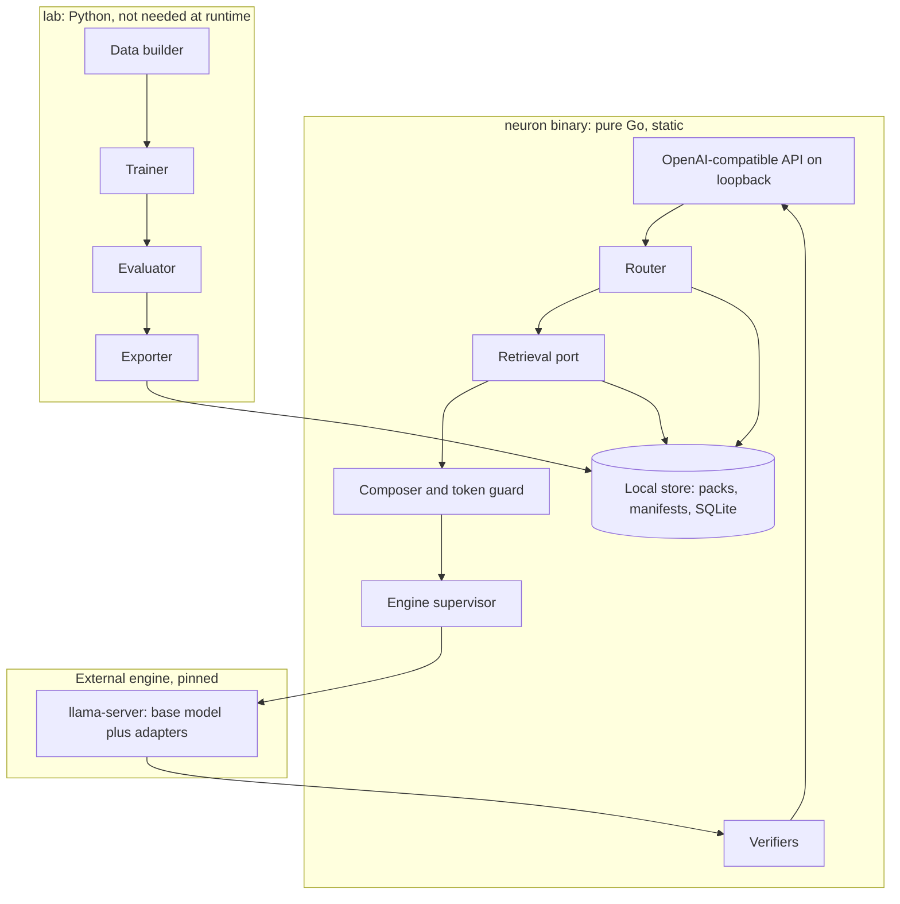
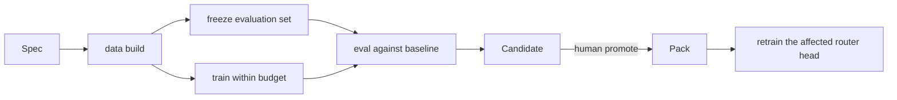

# Architecture

Status: design. Only the N0 foundation is implemented. Formats shown here are drafts, and
every number is a budget to confirm in milestone N0 (see [ROADMAP.md](../ROADMAP.md)).

## 1. The problem and the bet

A model under one billion parameters, quantized to four bits, runs on CPU threads at a
usable speed and fits in well under a gigabyte of memory. It also has little world
knowledge, loses track in long contexts, and follows complex instructions poorly.

The bet is that most useful requests inside a known domain decompose into parts that do
not need a capable generalist:

| Part of the work | What actually solves it |
|---|---|
| What is this request about? | A classifier |
| What facts does it need? | A search over the domain's documents |
| Which fields or entities does it contain? | A small extraction head |
| How should the answer be worded and shaped? | A small model tuned for that one sub-domain |
| Is the output well formed and supported? | A schema, a grammar, and code |

So the system splits the work first, and uses a generative model only for the one part
that needs it, with the facts supplied and the output shape enforced.

## 2. Vocabulary

| Term | Meaning |
|---|---|
| Neuron | One packaged specialist: artifact, manifest, evaluation report, provenance |
| Kind | What a neuron does: `route`, `extract`, `retrieve`, `generate`, `verify` |
| Pack | One domain: its router labels, neurons, and knowledge index |
| Cortex | The routing core in the runtime that composes neurons into an answer |
| Base | The shared generative model that `generate` neurons adapt |
| Adapter | A low-rank set of weights applied to the base for one sub-domain |
| Lab | The training side: data, training, evaluation, export |
| Spec | The declarative description a neuron is built from |
| Candidate | A trained neuron that has not been promoted by a human |
| Teacher | A more capable model that writes and labels training examples |
| Profile | A class of target machine: `nano`, `tiny`, `small` |

## 3. Components



**Runtime.** One static Go binary with CGO off. It routes, retrieves, composes prompts,
supervises the engine, verifies outputs, and serves the API. Router inference is plain
arithmetic over a static embedding table and a small head, so it needs no ML runtime.
See [ADR-0005](adr/0005-pure-go-runtime-python-lab-external-engine.md).

**Engine.** A pinned `llama-server` process runs the base model and its adapters. The
runtime talks to it over HTTP on loopback and never loads weights itself.

**Lab.** A Python package with locked dependencies. It builds datasets, trains, evaluates,
and exports artifacts into the store. A machine that only serves neurons does not need
Python at all.

**Store.** A directory under the neuron home: packs, manifests, artifacts addressed by
content hash, one SQLite database per knowledge pack, candidates, and reports.

## 4. Request path

1. **Guard.** Count tokens. A request that cannot fit the smallest applicable context
   budget fails with an explicit error.
2. **Route.** The router returns a path such as `uidl / forms / generate` with a
   confidence per level, or an abstention. Routing is hierarchical: a domain head, then
   that domain's sub-domain head, then a task head.
3. **Decide the plan.** The pack manifest says what the routed task needs. Many tasks end
   without generation: a lookup returns passages, an extraction returns fields.
4. **Retrieve.** For tasks that need facts, hybrid search over the pack's knowledge index
   returns a few passages inside a token budget, each with its source.
5. **Compose.** The neuron's static prefix, the retrieved passages, and the request are
   assembled. The prefix is identical for every request to that neuron, so the engine's
   prompt cache can reuse it.
6. **Generate.** The engine runs the base with the neuron's adapter, under the schema or
   grammar the manifest names, with a hard cap on output tokens.
7. **Verify.** Deterministic checks run on the output. On failure there is one bounded
   retry, then an abstention.
8. **Answer.** The response carries the result, the citations, the route taken, the
   neuron version, and whether it is an abstention or an escalation.

Abstention is a normal result, not an error. Escalation to a larger model is off by
default; when the operator configures an upstream, the response always says it was used.

## 5. The router

The router is not a language model
([ADR-0004](adr/0004-the-router-is-not-a-language-model.md)). It has three tiers, tried
in order of cost:

| Tier | Mechanism | When it decides |
|---|---|---|
| Rules | Explicit patterns declared by a pack | An unambiguous marker, such as a command prefix |
| Centroid | Nearest label centroid over static embeddings | A new label with few examples, before a head is trained |
| Head | A trained linear or small multi-layer head over pooled static embeddings | The default for every established label |

Properties the design depends on:

- **Hierarchy.** Adding a sub-domain retrains only that domain's sub-domain head, in
  seconds to minutes on a CPU. It does not touch other domains.
- **Calibration.** Confidence is calibrated on held-out data, including out-of-domain
  inputs, so the abstention threshold means something.
- **Abstention per level.** The router may be sure of the domain and unsure of the
  sub-domain. It then returns the domain and stops, and the pack's generalist neuron, if
  it has one, takes the request.
- **Feedback.** Abstentions and verifier failures are the signal the growth loop mines
  (section 10).

If Spike D shows that static embeddings are not accurate enough for a domain, the
fallback is a small transformer encoder served by the engine for that domain's head. The
cost is recorded in the pack's budget.

## 6. Knowledge packs and retrieval

Facts are never trained into weights
([ADR-0002](adr/0002-knowledge-in-retrieval-behaviour-in-weights.md)). Each pack carries a
read-only SQLite database built by `neuron knowledge build`:

- chunks sized for small contexts, with source path, line range, and licence;
- an FTS5 full-text index for bm25;
- static vectors per chunk, scanned in process.

A query runs both searches and fuses the ranks. Static embeddings are a table lookup and a
mean, so embedding a query costs microseconds on a CPU. They are weaker than a
transformer embedder for retrieval; the full-text half of the hybrid compensates, and
Spike F measures by how much. A pack may ship a rerank neuron when the measurement says
it is worth the latency.

Retrieval sits behind a port. The built-in store is one provider. A DONWI Brain
collection is another, for machines where DONWI Brain already indexes the same documents.

## 7. Generation

**One base, many adapters** ([ADR-0003](adr/0003-one-shared-base-with-adapters.md)). A
profile keeps one base model resident. Each generative neuron is a low-rank adapter of a
few tens of megabytes. Switching sub-domain selects another adapter; it does not load
another model.

**Small context by design.** A neuron declares its context budget, normally 2k tokens or
less: a short static prefix, a few retrieved passages, the request. Prompt evaluation
time on a CPU grows with every token, so the budget is a performance decision as much as
a quality one.

**Constrained decoding.** When the output is structured, the manifest names a JSON Schema
or a grammar, and the engine restricts decoding to it. A tiny model that cannot be
trusted to close a brace unaided becomes reliable about structure, and its capacity goes
to content.

**Fused exceptions.** If measurement shows an adapter is not enough for a sub-domain, or
that switching adapters costs more than keeping a second model, the neuron may ship as a
fused, quantized model. The manifest declares it and the memory budget accounts for it.

## 8. Verification

Verifiers are code first:

| Verifier | Checks |
|---|---|
| `json_schema` | The output validates against the neuron's schema |
| `citations_in_context` | Every cited span exists in the passages that were supplied |
| `allowed_values` | Enumerations, identifiers, and references resolve |
| `numeric` | Numbers and units copied from context match their source |
| Domain validator | An external validator, such as the UIDL schema validator |

A `verify` neuron (a small classifier) is used only where code cannot decide, for example
whether a free-text answer is supported by a passage. Its own precision is measured and
recorded like any other neuron.

## 9. How a neuron is made

A neuron is a build output. Its sources are the spec and the dataset; if the base model
changes, every adapter is rebuilt from them.



**Data sources**, each example tagged with source, licence, and audience
([ADR-0007](adr/0007-data-provenance-and-audience.md)):

- documents of the domain (they also feed the knowledge pack);
- synthetic examples written by a teacher from those documents;
- opt-in, redacted traces of real use.

**Evaluation set first.** The evaluation set is built, reviewed by sampling, frozen, and
hashed before training starts. It is built from seeds the training set does not see.
Without this, a teacher that wrote both sets would grade its own homework.

**Training methods by kind:**

| Kind | Method | Cost on an 8 GB machine (to confirm in N0) |
|---|---|---|
| `route`, `extract` | Head over static embeddings, or a small encoder | Seconds to minutes on CPU |
| `retrieve` | No training: build the index; optionally distil a domain static embedding | Minutes on CPU |
| `generate` | Low-rank adapter on the shared base, with retrieval-augmented examples | Tens of minutes to a few hours for a base of a few hundred million parameters |
| `verify` | Head over static embeddings on labelled supported or unsupported pairs | Minutes on CPU |

**Retrieval-augmented training.** A generative neuron is trained the way it will be used:
the prompt contains supporting passages mixed with distractors, and for a share of
examples no supporting passage at all, with an abstention as the target. The neuron
learns to use context, ignore noise, and decline, which an untuned tiny model does not do
reliably.

**Gates.** A candidate is promotable only if it meets every gate in its spec: an absolute
threshold, a margin over the untuned base, no regression against the previous version,
and its declared budgets.

**Agent-operable**
([ADR-0006](adr/0006-agent-operable-training-human-promotion.md)). Every lab command
takes a spec, prints a plan and its cost on dry-run, emits JSON, uses stable exit codes,
and can resume. An agent can author a spec, run the pipeline, read the report, and
iterate. It cannot promote.

## 10. Growth loop

The runtime keeps an opt-in, local log of what it routed, how confident it was, and what
the verifiers said. Request content is hashed or redacted by default. From it:

| Signal | Proposal |
|---|---|
| A cluster of similar requests the router abstained on | A new sub-domain: draft spec plus the evidence |
| A neuron whose verifier pass rate fell | Retrain, or review its knowledge pack first |
| Requests that retrieve nothing useful | Rebuild or extend the knowledge pack; no training |
| A promoted neuron that no longer receives traffic | Demotion proposal |

Approved specs run as scheduled jobs when the machine is idle and inside their budgets.
Results are candidates. Nothing is promoted or removed automatically. Content that
reaches the lab from logs or traces is untrusted: a candidate built from data containing
instruction-like text is flagged, and the flag is shown at promotion.

## 11. Budgets and profiles

Budgets are part of every manifest and every job
([ADR-0008](adr/0008-resource-budgets-are-part-of-the-contract.md)).

- A neuron manifest states, per profile, its measured resident memory, disk size, context
  budget, and expected latency.
- The runtime adds up what a profile would keep resident and refuses a configuration that
  does not fit, at load time, with the numbers in the error.
- A lab job states its wall time, peak memory, and disk. The guard stops a job that
  exceeds them and refuses one that would leave less than a safety margin of free disk.

Memory on the `tiny` profile, as a design budget: runtime and router under 100 MB, one
knowledge pack memory-mapped, one base at four bits with a 2k context, and loaded
adapters at tens of megabytes each. For scale, DONWI Brain measured a 0.6B model at four
bits at about 800 MB resident with a 4k context
([DONWI Brain ADR-0002](https://github.com/hi-donwi/Donwi-Brain/blob/main/docs/adr/0002-orchestrate-existing-inference-backends.md)).

## 12. Draft formats

Illustrative only. Field names and values are settled in N1 and N2.

```yaml
# neuron.yaml
neuron: uidl/forms
kind: generate
version: sha256:<hash of manifest and artifacts>
base: <base model id>@<hash>
artifact:
  adapter: adapter.gguf
context:
  max_tokens: 2048
  static_prefix: prompt/system.txt
  retrieval: { top_k: 4, max_tokens: 900 }
output:
  max_tokens: 400
  schema: schema/form-document.json
verify: [json_schema, citations_in_context]
budget:
  tiny: { resident_mb: 60, first_token_ms: 800 }
provenance:
  spec: sha256:<hash>
  dataset: sha256:<hash>
  audience: public
  base_licence: <as written on the model card>
eval:
  report: eval/report.json
```

```yaml
# pack.yaml
pack: uidl
labels: [uidl/forms, uidl/lists, uidl/dashboards]
router: router/
knowledge: knowledge.db
neurons: [forms, lists, dashboards]
generalist: none
```

```yaml
# spec.yaml
spec: uidl/forms
kind: generate
task: Produce a UIDL form document from a short description.
data:
  sources:
    - { path: docs/, audience: public, licence: MIT }
  synthesize: { teacher: <endpoint or profile>, examples: 3000, distractors: 3, abstain_share: 0.15 }
  eval: { size: 300, review: sampled }
train: { method: lora, rank: 8 }
budget: { wall_minutes: 90, peak_memory_mb: 4500, disk_mb: 1500 }
gates:
  - { metric: schema_valid_rate, min: 0.97 }
  - { metric: margin_over_base, min: 0.10 }
  - { metric: abstain_precision, min: 0.90 }
```

## 13. Security and privacy

- **Local by default.** The API binds to loopback with a per-process bearer token and a
  Host header check. No telemetry. The only egress is a teacher or an escalation endpoint
  the operator configured.
- **Audience.** A neuron's audience is the most restrictive audience among its data. A
  private neuron cannot be exported for publication; the lab refuses.
- **Licences.** The base model's licence and each data source's licence are recorded in
  the manifest and carried into the generated model card.
- **Teacher terms.** Before a teacher is used, the operator confirms its terms allow its
  outputs to be used as training data. The spec records the teacher, and a dataset for a
  public neuron is refused when its teacher is not on the operator's allow list.
- **Untrusted training data.** Documents, traces, and teacher outputs can carry
  instructions or poison. Defences are the frozen evaluation set, gates, flags on
  instruction-like content, and human promotion.
- **Integrity.** Packs and artifacts are addressed by content hash; `packs verify` fails
  on any mismatch.

## 14. Fit with the suite

DONWI Neuron is a backend, not a second gateway
([ADR-0001](adr/0001-separate-repository-beside-agent-brain.md)). It has no provider
accounts, no skills runtime, no agent loop, and no console. DONWI Brain stays the one
endpoint clients use, and reaches `neuron serve` as a local account. On a bare low-end
device with nothing else installed, `neuron serve` alone is enough.

## 15. Open questions for N0

| Question | Spike |
|---|---|
| Which base models, measured on CPU threads, fit each profile, and under which licences? | A |
| Which training path yields a GGUF adapter from an 8 GB machine? | B |
| Is per-request adapter selection reliable and fast enough in the pinned engine? | C |
| Are static embeddings accurate enough to route, and where do they need help? | D ([measured](spikes/d-router-quality.md)) |
| Does pure-Go router inference match the Python reference? | E |
| How much retrieval quality do static vectors give up, and does the hybrid recover it? | F |
